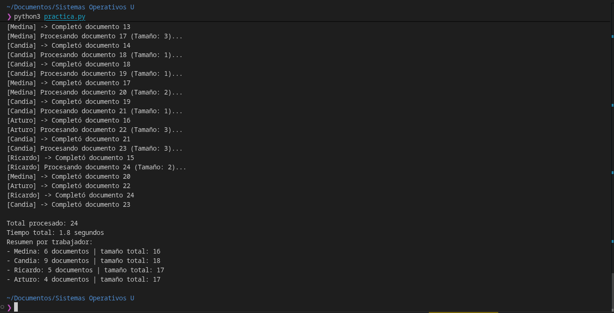
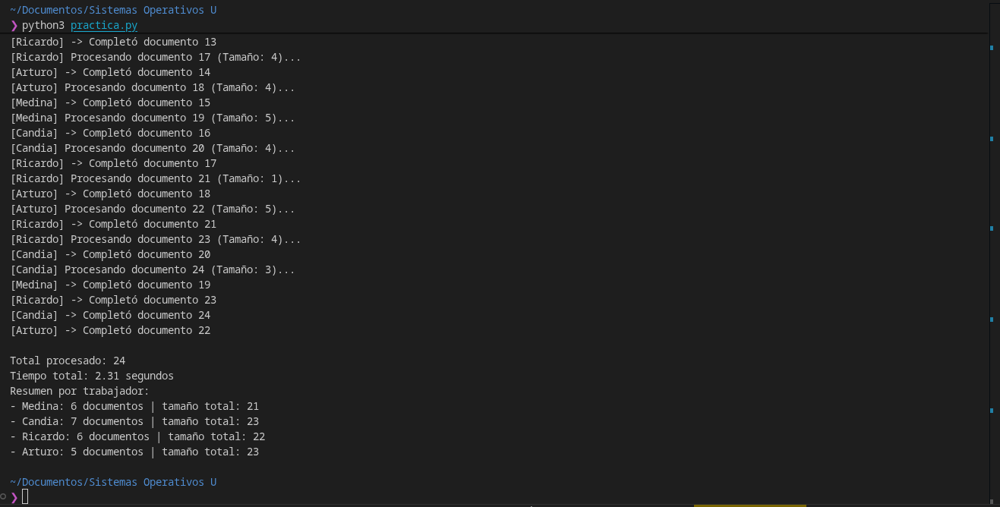
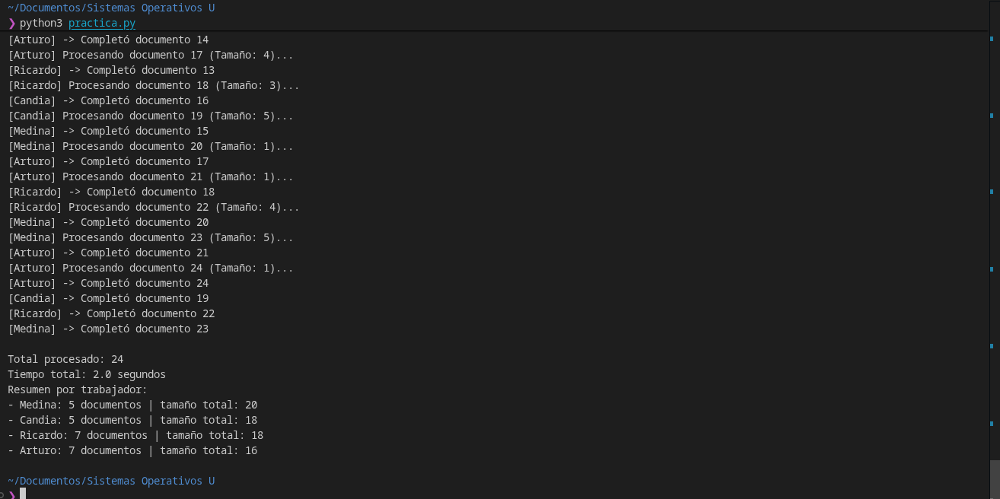
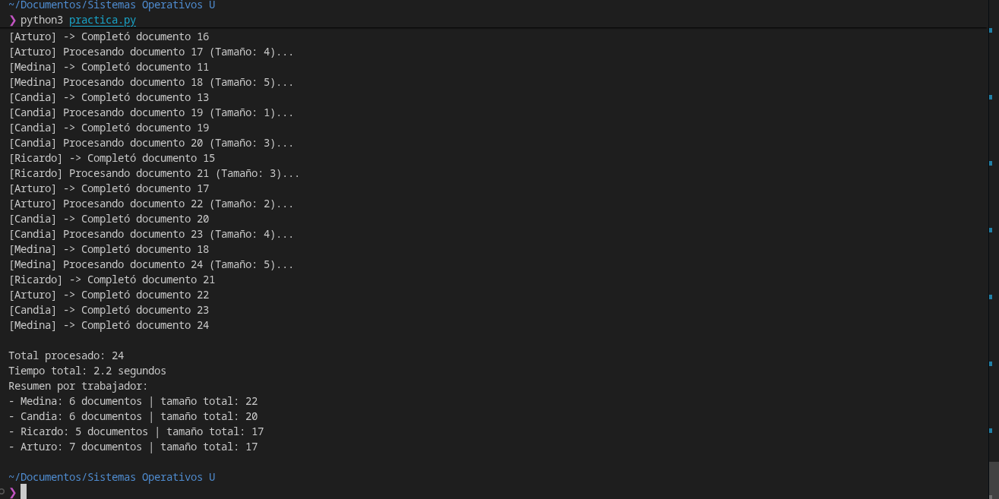

# Práctica: Sistema de Procesamiento de Documentos Concurrentes

## 1. Archivo de Código Fuente
El código fuente de la práctica se encuentra en el archivo [`practica.py`](practica.py).

### Descripción del Funcionamiento
- **Estructura de datos**: Se utiliza una cola sincronizada y segura para hilos (`queue.Queue`) cargada con 24 documentos identificados del 1 al 24, cada uno con un tamaño aleatorio entre 1 y 5.
- **Hilos trabajadores**: 4 hilos concurrentes nombrados en honor a los integrantes del equipo:
  - `Medina`
  - `Candia`
  - `Ricardo`
  - `Arturo`
- **Simulación de procesamiento**: Cada trabajador extrae tareas de forma no bloqueante (`get_nowait()`) y simula el tiempo de procesamiento mediante `time.sleep(tamano * 0.1)`.
- **Sincronización y Exclusión Mutua**: Se emplea `threading.Lock()` para garantizar que la actualización de las métricas compartidas (`resultados` y `tamanos`) se realice de manera atómica, previniendo condiciones de carrera.

---

## 2. Capturas de Ejecución (4 Pruebas)

A continuación se presentan las 4 ejecuciones del programa en el entorno de terminal:

### Captura 1 (Prueba 1.2)

*(Archivo original: `Prueba 1.2.png`)*

- **Tiempo total**: 1.8 segundos
- **Total de documentos procesados**: 24
- **Resumen por trabajador**:
  - `Medina`: 6 documentos | tamaño total: 16
  - `Candia`: 9 documentos | tamaño total: 18
  - `Ricardo`: 5 documentos | tamaño total: 17
  - `Arturo`: 4 documentos | tamaño total: 17

---

### Captura 2 (Prueba 2.2)

*(Archivo original: `Prueba 2.2.png`)*

- **Tiempo total**: 2.31 segundos
- **Total de documentos procesados**: 24
- **Resumen por trabajador**:
  - `Medina`: 6 documentos | tamaño total: 21
  - `Candia`: 7 documentos | tamaño total: 23
  - `Ricardo`: 6 documentos | tamaño total: 22
  - `Arturo`: 5 documentos | tamaño total: 23

---

### Captura 3 (Prueba 3.2)

*(Archivo original: `Prueba 3.2.png`)*

- **Tiempo total**: 2.0 segundos
- **Total de documentos procesados**: 24
- **Resumen por trabajador**:
  - `Medina`: 5 documentos | tamaño total: 20
  - `Candia`: 5 documentos | tamaño total: 18
  - `Ricardo`: 7 documentos | tamaño total: 18
  - `Arturo`: 7 documentos | tamaño total: 16

---

### Captura 4 (Prueba 4.2)

*(Archivo original: `Prueba 4.2.png`)*

- **Tiempo total**: 2.2 segundos
- **Total de documentos procesados**: 24
- **Resumen por trabajador**:
  - `Medina`: 6 documentos | tamaño total: 22
  - `Candia`: 6 documentos | tamaño total: 20
  - `Ricardo`: 5 documentos | tamaño total: 17
  - `Arturo`: 7 documentos | tamaño total: 17

---

## 3. Interpretación del Comportamiento

### Análisis Individual por Ejecución

1. **Interpretación de la Prueba 1 (Tiempo: 1.8 s - Carga total: 68 unidades)**:
   - **Distribución de documentos**: Se observa una aparente disparidad en la cantidad de documentos procesados: Candia procesó 9 documentos mientras que Arturo procesó únicamente 4.
   - **Causa del comportamiento**: Al analizar la traza de ejecución, se evidencia que a Candia le correspondieron documentos de tamaño muy pequeño (por ejemplo, documentos 18, 19 y 21 con tamaño 1). Al requerir únicamente 0.1 s de espera, Candia retornaba a la cola casi de inmediato y tomaba nuevas tareas, mientras Arturo y Ricardo se encontraban retenidos procesando documentos de tamaño 3 a 5.
   - **Equilibrio de carga real**: A pesar de la diferencia en número de documentos (9 vs 4), el tamaño acumulado de trabajo fue sumamente parejo (Candia: 18, Ricardo: 17, Arturo: 17, Medina: 16). Esto demuestra que el sistema balancea la carga en función del tiempo de servicio y no del conteo nominal.

2. **Interpretación de la Prueba 2 (Tiempo: 2.31 s - Carga total: 89 unidades)**:
   - **Mayor duración de ejecución**: Esta corrida registró el mayor tiempo de ejecución (2.31 segundos). La razón matemática directa es que los tamaños aleatorios asignados a los 24 documentos sumaron 89 unidades de trabajo (frente a las 68 unidades de la Prueba 1). Al existir una mayor cantidad de documentos con tamaño máximo (4 y 5), la cola tardó más en vaciarse.
   - **Simetría de procesamiento**: El balance tanto en cantidad de documentos (entre 5 y 7) como en tamaño total acumulado (entre 21 y 23 unidades por hilo) fue prácticamente homogéneo, reflejando una utilización uniforme de los 4 núcleos/hilos concurrentes.

3. **Interpretación de la Prueba 3 (Tiempo: 2.0 s - Carga total: 72 unidades)**:
   - **Inversión de liderazgo en tareas**: En esta ocasión, Ricardo y Arturo lideraron la cantidad de documentos completados con 7 cada uno, mientras que Medina y Candia completaron 5 cada uno.
   - **Relación Documentos vs Carga**: Medina procesó únicamente 5 documentos, pero acumuló un tamaño total de 20 (promedio de 4.0 por documento). Por el contrario, Arturo procesó 7 documentos sumando un tamaño de 16 (promedio de ~2.3 por documento). Esto ratifica que procesar menos documentos no implica menor esfuerzo computacional cuando las tareas tienen duraciones heterogéneas.

4. **Interpretación de la Prueba 4 (Tiempo: 2.2 s - Carga total: 76 unidades)**:
   - **No determinismo en la extracción final**: El último documento de la cola (documento 24, con tamaño 5) fue tomado y finalizado por Medina, mientras Arturo y Candia culminaban los documentos 22 y 23. Esto evidencia que el orden de extracción y resolución no es secuencial estricto respecto a los identificadores, sino que depende de cuándo cada hilo se libera y accede a la cola.
   - **Estabilidad del tiempo**: Con una carga acumulada de 76 unidades distribuida entre 4 hilos, el tiempo total observado fue de 2.2 s, concordando de forma precisa con el modelo teórico de concurrencia ($7.6\text{ s} / 4 \approx 1.9\text{ s} + \text{overhead} \approx 2.2\text{ s}$).

---

### Análisis Teórico y Transversal del Sistema Concurrente

- **No Determinismo y Planificación del Sistema Operativo**:
  En cada ejecución, el orden de salida por consola y el orden de extracción de los documentos varió de manera no determinista. Esto se debe a que el planificador de hilos del Sistema Operativo distribuye los quantums de tiempo de CPU y gestiona los cambios de contexto (*context switching*) según la concurrencia del hardware, el estado de las llamadas bloqueantes (`time.sleep`) y la contención en las primitivas de sincronización.
  
- **Auto-balanceo Dinámico de Carga (Dynamic Work-Sharing)**:
  La arquitectura basada en una cola centralizada compartida (`queue.Queue`) evita la partición rígida o estática de tareas (como asignar 6 documentos prefijados a cada trabajador). Gracias al paradigma productor-consumidor, los trabajadores que reciben tareas cortas quedan libres más rápido y extraen dinámicamente el siguiente ítem disponible, maximizando la utilización de los recursos y reduciendo los tiempos de inactividad de los hilos.

- **Efectividad de la Exclusión Mutua (`threading.Lock`)**:
  En todas y cada una de las 4 pruebas, la suma de los documentos procesados por los cuatro trabajadores fue exactamente **24**, y la suma de tamaños coincidió sin discrepancias. Esto certifica que la sección crítica:
  ```python
  with lock:
      resultados[nombre] = resultados.get(nombre, 0) + 1
      tamanos[nombre] = tamanos.get(nombre, 0) + tamano
      print(f"[{nombre}] -> Completó documento {doc_id}")
  ```
  impidió condiciones de carrera sobre los diccionarios globales, garantizando la atomicidad e integridad de las variables compartidas.

- **Evaluación del Rendimiento y Speedup Concurrente**:
  - Carga secuencial acumulada observada: entre 6.8 s y 8.9 s.
  - Tiempo real de ejecución con 4 hilos: entre 1.8 s y 2.31 s.
  - **Factor de aceleración (*Speedup*)**:
    $$\text{Speedup} = \frac{T_{\text{secuencial}}}{T_{\text{concurrente}}} \approx \frac{6.8}{1.8} \approx 3.77\text{x} \quad \text{a} \quad \frac{8.9}{2.31} \approx 3.85\text{x}$$
  Este resultado se aproxima de manera sobresaliente al límite teórico ideal de 4x para 4 hilos en operaciones limitadas por E/S o temporización (I/O-bound / sleeping), confirmando la eficiencia de la paralelización.

---

## 4. Preguntas y Respuestas Teóricas

### 1. ¿Por qué `queue.Queue` es apropiada para compartir trabajos?
`queue.Queue` es una estructura de datos diseñada específicamente para entornos multi-hilo (*thread-safe*). Maneja internamente las primitivas de sincronización necesarias (utilizando semáforos y variables de condición bajo el capó) para que operaciones como `put()` y `get_nowait()` sean atómicas. Esto asegura que dos trabajadores no puedan extraer el mismo documento simultáneamente y evita condiciones de carrera sobre la cola sin necesidad de implementar locks externos adicionales.

### 2. ¿Qué protege `Lock` y qué pasaría si se actualizara el resumen sin él?
El `Lock` (`threading.Lock()`) protege el acceso y la modificación concurrente de los diccionarios compartidos `resultados` y `tamanos`. 

En Python, operaciones como:
```python
resultados[nombre] = resultados.get(nombre, 0) + 1
tamanos[nombre] = tamanos.get(nombre, 0) + tamano
```
no son atómicas a nivel de bytecode (involucran lectura, adición en pila y reasignación). Si dos o más hilos intentan actualizar los diccionarios al mismo tiempo sin un lock, ocurre una **condición de carrera (race condition)** donde un hilo puede sobrescribir el valor del otro, provocando pérdida de actualizaciones y arrojando un conteo total inconsistente (menor a 24).

### 3. ¿Qué cambiarías si cada documento tuviera que guardarse en un archivo real?
Depende de la estrategia de persistencia adoptada:
- **Archivo único compartido** (ej. `salida.txt`): Se debe utilizar un `Lock` para sincronizar las operaciones de escritura en disco (`file.write(...)`), evitando que las líneas se intercalen de forma corrupta o que ocurran colisiones de I/O.
- **Archivo individual por trabajador** (ej. `Medina.txt`, `Candia.txt`): No se requiere lock para la escritura, ya que cada hilo maneja su propio descriptor de archivo de forma totalmente independiente.
- **Archivo individual por documento** (ej. `doc_1.txt`, `doc_2.txt`): Dado que cada documento se extrae de forma unívoca de la cola de trabajo, cada hilo escribe en un archivo con nombre distinto; por lo tanto, no existe contención ni se requiere sincronización entre hilos.

---

## 5. Reto Adicional: Comparación Secuencial vs Concurrente

### Comparación de Tiempos
- **Versión secuencial**: Un solo hilo procesaría los 24 documentos uno tras otro. Si la suma de los tamaños simulados promedia entre 68 y 89 unidades a razón de `tamano * 0.1` s cada una, el tiempo total secuencial oscila entre **~6.8 y 8.9 segundos**.
- **Versión con 4 hilos concurrentes**: Al distribuirse el trabajo entre Medina, Candia, Ricardo y Arturo en paralelo, el tiempo total se reduce a **~1.8 a 2.31 segundos**, logrando un factor de aceleración cercano a **3.8x**.

### ¿Por qué la diferencia puede ser pequeña en este ejemplo artificial?
1. **Sobrecarga de gestión de hilos (Overhead)**: El sistema operativo incurre en tiempo adicional para instanciar hilos, cambiar contextos (*context switching*) y coordinar la adquisición/liberación del `Lock`.
2. **Duración muy corta de las tareas**: Al multiplicar el tamaño por `0.1`, las pausas duran apenas décimas de segundo (0.1 a 0.5 s), haciendo que el tiempo de gestión del sistema represente una porción más visible en proporción al tiempo de cálculo real.
3. **GIL (Global Interpreter Lock)**: Aunque `time.sleep()` libera el GIL permitiendo verdadera concurrencia durante los periodos de espera, en algoritmos CPU-intensivos puros en Python estándar (CPython), el GIL restringiría la ejecución de bytecode a un solo núcleo a la vez.

---

## 6. Verificaciones del Sistema
- **Verificación 1**: La suma de los documentos completados por los 4 trabajadores en todas las pruebas es exactamente 24 (`Total procesado: 24`).
- **Verificación 2**: Cada documento de la cola compartida es extraído y procesado exactamente una vez (sin duplicaciones ni omisiones).
- **Verificación 3**: Los cuatro hilos finalizan su ejecución de forma limpia y controlada mediante `get_nowait()` y la captura de la excepción `queue.Empty`, terminando correctamente tras el `join()`.
